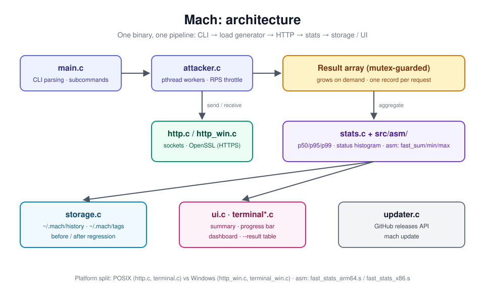

# ⚡ Mach

**A fast HTTP load tester written in C, with hand-optimized assembly for the stats hot path.**

[](https://github.com/HiteshGorana/mach/actions/workflows/build.yml)




## Install

```bash
git clone https://github.com/HiteshGorana/mach.git
cd mach
sh scripts/install.sh          # macOS/Linux
.\scripts\install.ps1          # Windows (PowerShell)
```

Pre-built binaries are also on the [Releases](https://github.com/HiteshGorana/mach/releases) page.

**Update and uninstall**

```bash
mach update --check            # is a newer release available?
mach update                    # install it
sh scripts/install.sh --uninstall           # remove the binary, keep history
sh scripts/install.sh --uninstall --purge   # also delete ~/.mach
```

On Windows, use `-Uninstall` (and `-Purge`) with `install.ps1`.

## Quick start

```bash
mach http://localhost:8080                  # single run with defaults
mach -n 1000 -c 50 http://example.com       # 1000 requests, 50 workers
mach -d 5m -c 20 http://api.example.com     # 5-minute soak
mach --profile stress http://example.com    # preset
```

## Usage

```
mach [command] [options] <url>

Commands:
  attack       Full load test (default when a URL is given)
  dashboard    Browse past runs interactively
  history      List or clear saved runs (history clear)
  examples     Show usage examples
  update       Update to the latest release
  version      Show version

Options:
  -n INT         Total requests (default 100)
  -d DURATION    Run for a duration instead, e.g. 30s, 5m
  -c INT         Concurrent workers (default 10)
  -r INT         Aggregate requests-per-second limit
  -m METHOD      HTTP method (default GET)
  -h "K: V"      Add a header, e.g. "Authorization: Bearer TOKEN"
  -b BODY        Request body
  --body-file F  Read the request body from a file
  --urls-file F  Test each URL listed in a file (one per line)
  -t DURATION    Per-request timeout, e.g. 5s
  --ramp-up DUR  Stagger worker start over this duration
  -p NAME        Preset: smoke, stress, soak (also --profile)
  -k             Skip TLS certificate verification (also --insecure)
  --tag NAME     Name a comparison series
  --before       Save this run as the baseline for --tag
  --after        Save this run as the target for --tag
  --result       Show the before/after comparison for --tag
  --threshold PCT Fail if average latency regresses more than PCT
  --output FILE  Write the run summary as JSON to FILE
  -q, --quiet    No progress bar or summary (errors still shown)
  --no-color     Disable ANSI colors
```

| Profile | Requests | Concurrency | Use case |
|:--------|:---------|:------------|:---------|
| `smoke` | 10 | 2 | Sanity check |
| `stress` | 10,000 | 100 | High load |
| `soak` | Duration | 50 | Long-running stability |

## Examples

**POST a JSON body**
```bash
mach -m POST -h "Content-Type: application/json" \
     -b '{"name": "test", "value": 123}' https://api.example.com/v1/data
```

**Rate-limited run**
```bash
mach -r 50 -d 30s https://api.example.com
```

**Several URLs** (one per line in a file)
```bash
mach -n 1000 -c 20 --urls-file urls.txt
```

## Regression testing

Compare performance across code changes:

```bash
mach --tag perf-fix --before -n 1000 http://api.com   # baseline
mach --tag perf-fix --after  -n 1000 http://api.com   # after your change
mach --tag perf-fix --result                          # comparison table
```

For CI, add a threshold so the run fails on a regression:

```bash
mach --tag release-1.1 --after --threshold 5 -n 1000 http://api.com
```

## Build from source

```bash
make              # build for this platform
make debug        # symbols, no stripping
make asan         # address and undefined-behavior sanitizers
```

Requirements: GCC or Clang, Make, and OpenSSL 3 (`brew install openssl@3` on macOS).

## License

MIT © [Hitesh Gorana](https://github.com/HiteshGorana)
